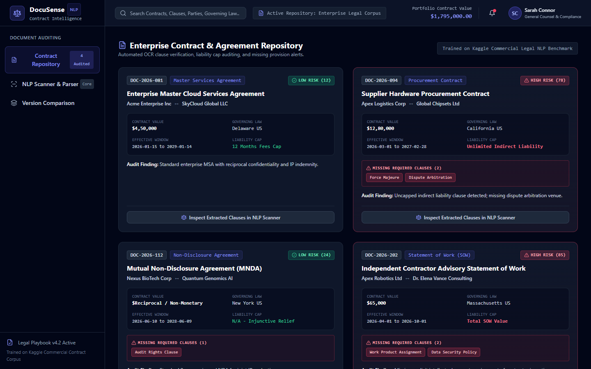
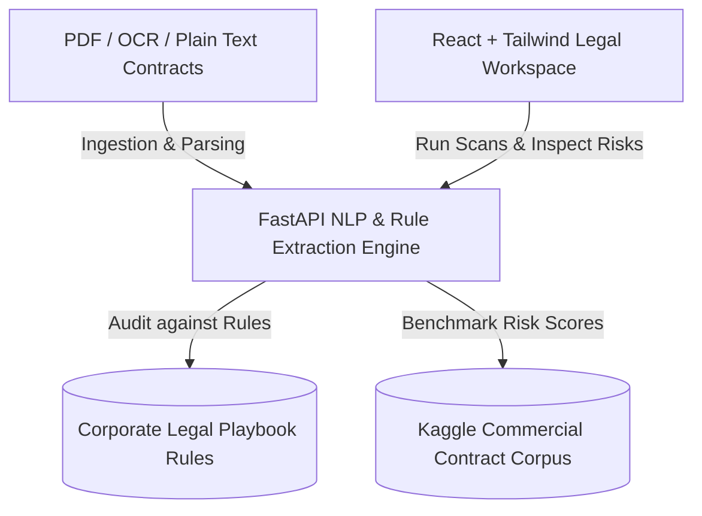

# DocuSense — Intelligent Document Understanding & Contract Intelligence Engine

[](LICENSE)
[](https://www.python.org/)
[](https://fastapi.tiangolo.com/)
[](https://react.dev/)
[](https://tailwindcss.com/)
[](data/kaggle_contracts_document_understanding_benchmark.csv)
[](https://www.docker.com/)

DocuSense is an enterprise document understanding and legal contract analytics platform. Leveraging NLP information extraction and pattern matching, it automatically extracts key contract entities, audits limitation of liability caps, identifies missing mandatory legal provisions, and flags contract risk before signature.

---

## 📸 System Dashboard & Contract Intelligence Repository



---

## 🌟 Key Capabilities & Standout Features

- **Automated Clause & Key-Value Extraction**: Identifies parties, effective dates, contract values, governing law, and key operational covenants.
- **Mandatory Legal Playbook Auditing**: Automatically verifies the presence of vital legal clauses (Confidentiality, Intellectual Property Assignment, Limitation of Liability, Force Majeure, and Dispute Arbitration).
- **Uncapped Liability & Indemnity Alerting**: Detects exposure to uncapped consequential or indirect damages.
- **Contract Risk Scoring (0–100)**: Quantitative risk scoring based on missing clauses, indemnity ambiguity, and unfavorable jurisdiction terms.
- **Side-by-Side Version Comparison**: Compare terms across contract drafts or vendor-submitted revisions.

---

## 🏛 Architecture Overview



---

## 📊 Dataset Benchmark

The repository includes a curated benchmark in [`data/kaggle_contracts_document_understanding_benchmark.csv`](data/kaggle_contracts_document_understanding_benchmark.csv) covering:
- `doc_id`: Contract identifier (e.g., `DOC-2026-081`)
- `title` & `document_type`: Master Services Agreements (MSA), Non-Disclosure Agreements (MNDA), Statements of Work (SOW), and Commercial Leases
- `party_a` & `party_b`: Signatory entities
- `effective_date` & `termination_date`: Temporal validity
- `contract_value_usd` & `governing_law`: Monetary exposure and legal venue
- `liability_cap` & `missing_clauses`: Detected indemnities and compliance gaps
- `risk_score` & `compliance_status`: Risk quantification (`COMPLIANT`, `LOW_RISK`, `HIGH_RISK_ALERT`, `CRITICAL_RISK`)

---

## 🔌 API Reference

| Endpoint | Method | Description |
| :--- | :--- | :--- |
| `/health` | `GET` | Health check & service readiness |
| `/api/v1/analytics/compliance-summary` | `GET` | Portfolio statistics on analyzed documents and common missing clauses |
| `/api/v1/documents` | `GET` | List all indexed agreements with compliance ratings |
| `/api/v1/documents/{doc_id}` | `GET` | Detailed clause-by-clause extraction and confidence breakdown |
| `/api/v1/documents/parse-text` | `POST` | Execute live NLP entity extraction on raw text; returns risk score & missing clauses |

---

## 🚀 Quickstart Guide

### Option 1: Docker Compose (Recommended)

```bash
docker-compose up --build
```
- Web Application: `http://localhost:3005`
- FastAPI Interactive Swagger: `http://localhost:8001/docs`

### Option 2: Local Development

#### 1. Backend Service
```bash
cd backend
python -m venv venv
source venv/bin/activate  # On Windows: .\venv\Scripts\activate
pip install -r requirements.txt
uvicorn app.main:app --reload --port 8001
```

#### 2. Frontend Application
```bash
cd frontend
npm install
npm run dev
```

---

## 📄 License
This project is licensed under the MIT License.
